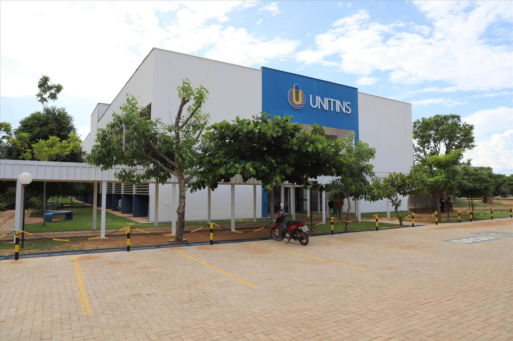
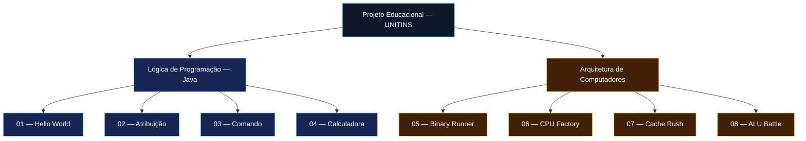
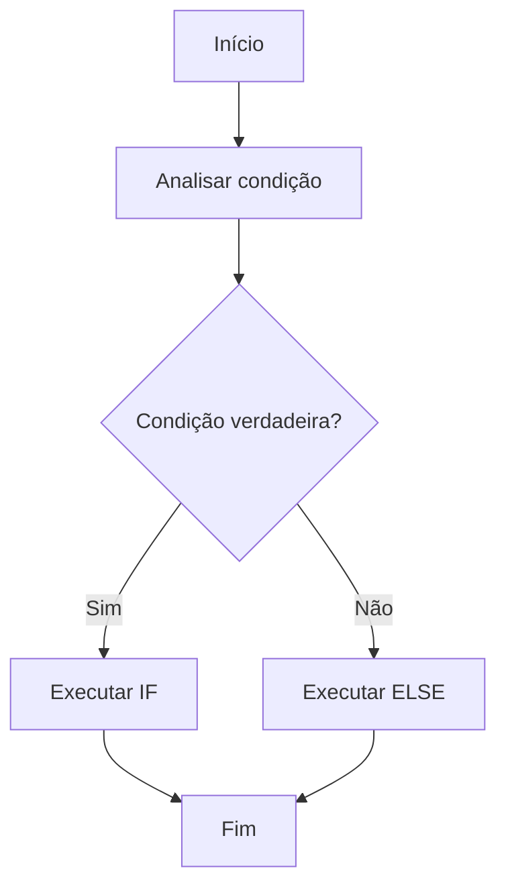
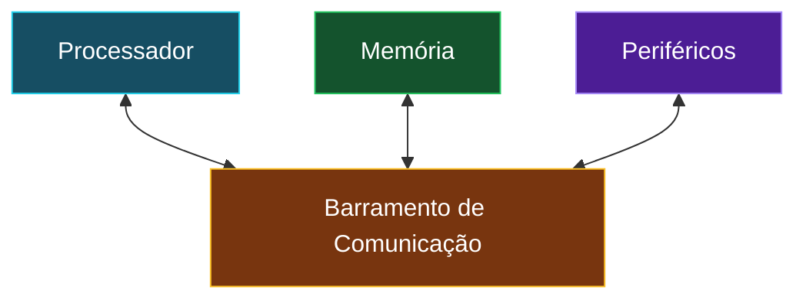
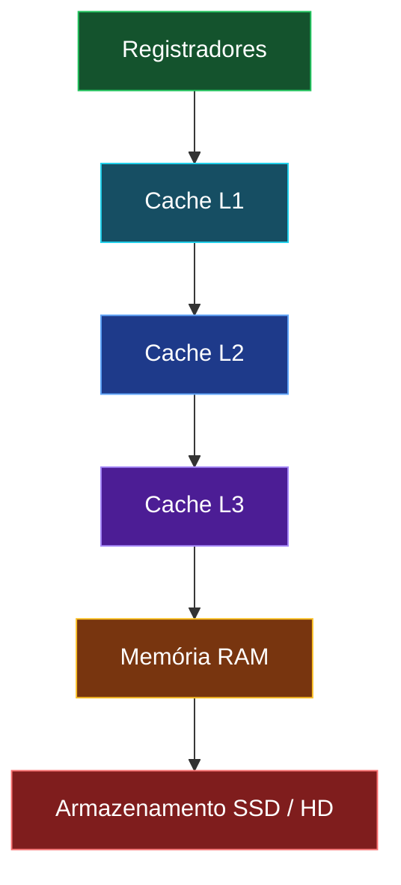
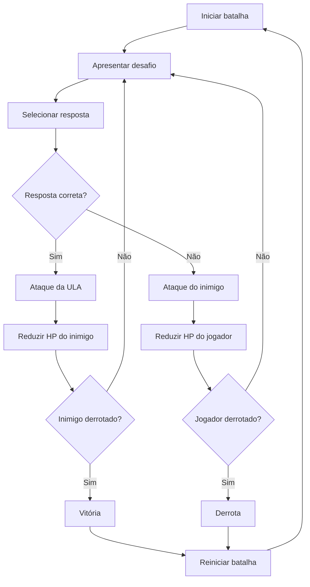
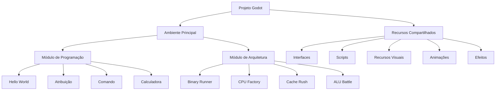

<div align="center">

# 🎮 Projeto Educacional — UNITINS

### Integração Teórico-Prática através de Jogos Digitais

**Lógica de Programação e Arquitetura de Computadores**




**Universidade Estadual do Tocantins — UNITINS**

*Transformando conhecimentos teóricos em experiências interativas.*

</div>

---

## 📖 Sobre o projeto

Este projeto foi desenvolvido no contexto do estágio acadêmico
da Universidade Estadual do Tocantins (UNITINS), com foco na
aplicação da gamificação como ferramenta de apoio ao ensino
de conteúdos relacionados à computação.

A proposta consiste na criação de um ambiente virtual
interativo, desenvolvido utilizando a Godot Engine, que integra
oito minijogos educacionais fundamentados em duas áreas
de conhecimento:

- Lógica de Programação, com foco na linguagem Java.
- Arquitetura e Organização de Computadores.

Cada minijogo apresenta uma abordagem diferente de aprendizagem,
utilizando desafios, simulações, resolução de problemas,
interatividade e elementos de jogos digitais.

O projeto busca aproximar os estudantes dos conteúdos teóricos,
proporcionando uma experiência prática, dinâmica e intuitiva.

---

## 📑 Sumário

- [Objetivos](#-objetivos)
- [Metodologia](#-metodologia)
- [Minijogos educacionais](#-minijogos-educacionais)
- [Lógica de Programação](#-lógica-de-programação-java)
- [Arquitetura de Computadores](#-arquitetura-e-organização-de-computadores)
- [Arquitetura do projeto](#-arquitetura-do-projeto)
- [Tecnologias utilizadas](#-tecnologias-utilizadas)
- [Estrutura de diretórios](#-estrutura-de-diretórios)
- [Como executar](#-como-executar)
- [Demonstrações](#-demonstrações)
- [Trabalhos futuros](#-trabalhos-futuros)
- [Contexto acadêmico](#-contexto-acadêmico)
- [Referências](#-referências)
- [Desenvolvedor](#-desenvolvedor)

---

## 🎯 Objetivos

### Objetivo geral

Desenvolver uma ferramenta educacional interativa baseada
em jogos digitais, capaz de auxiliar na aprendizagem dos
fundamentos de Lógica de Programação e Arquitetura
e Organização de Computadores.

### Objetivos específicos

- Aplicar a gamificação como estratégia de aprendizagem.
- Promover a integração entre teoria e prática.
- Estimular o raciocínio lógico e computacional.
- Facilitar a compreensão dos fundamentos da linguagem Java.
- Demonstrar a organização interna dos computadores.
- Simular o funcionamento da hierarquia de memórias.
- Trabalhar conceitos de sistemas de numeração.
- Desenvolver habilidades de resolução de problemas.
- Proporcionar uma experiência educacional interativa.
- Incentivar a autonomia dos estudantes durante a aprendizagem.

---

## 🧩 Metodologia

O projeto utiliza uma abordagem de aprendizagem baseada
em jogos digitais, na qual os conteúdos acadêmicos são
transformados em desafios interativos.

A metodologia combina:

- Gamificação.
- Aprendizagem baseada em jogos (Game-Based Learning).
- Experimentação prática.
- Resolução de problemas.
- Simulação de conceitos computacionais.
- Feedback visual.
- Interação com interfaces gráficas.
- Aprendizagem por tentativa e erro.

O estudante participa ativamente das atividades, aplicando
os conhecimentos estudados em diferentes situações
apresentadas pelos minijogos.

---

## 🎮 Minijogos educacionais

O projeto é composto por oito minijogos, organizados
em dois módulos educacionais.

| Nº | Minijogo | Área de conhecimento | Conteúdo principal |
|:---:|:---|:---|:---|
| 01 | Hello World | Lógica de Programação | Sintaxe básica e saída de dados |
| 02 | Atribuição | Lógica de Programação | Variáveis e tipos primitivos |
| 03 | Comando | Lógica de Programação | Estruturas condicionais |
| 04 | Calculadora | Lógica de Programação | Operadores aritméticos e eventos |
| 05 | Binary Runner | Arquitetura de Computadores | Conversão de bases numéricas |
| 06 | CPU Factory | Arquitetura de Computadores | Montagem de computadores |
| 07 | Cache Rush | Arquitetura de Computadores | Hierarquia de memórias |
| 08 | ALU Battle | Arquitetura de Computadores | Operações matemáticas na ULA |

### Organização dos módulos



---

# ☕ Lógica de Programação (Java)

Este módulo apresenta os fundamentos da programação,
utilizando conceitos introdutórios da linguagem Java.

Seu objetivo é auxiliar os estudantes na compreensão
da sintaxe, das variáveis, das estruturas condicionais
e das operações aritméticas.

---

## 01 — Hello World

> Introdução à programação e saída de dados.

O primeiro minijogo apresenta os conceitos iniciais
da linguagem Java, utilizando o tradicional programa
Hello World como ponto de partida.

### Conteúdos abordados

- Sintaxe básica da linguagem Java.
- Estrutura de comandos.
- Exibição de mensagens.
- Saída de dados.
- Utilização de `System.out.println()`.

### Exemplo educacional

```java
public class Main {
    public static void main(String[] args) {
        System.out.println("Hello World!");
    }
}
```

### Objetivo educacional

Compreender a estrutura inicial de um programa Java
e identificar como as informações são exibidas
durante sua execução.

---

## 02 — Atribuição

> Variáveis e tipos de dados primitivos.

O minijogo Atribuição trabalha os conceitos de declaração
de variáveis, atribuição de valores e identificação dos
tipos de dados utilizados na programação.

### Conteúdos abordados

- Declaração de variáveis.
- Atribuição de valores.
- Tipos primitivos.
- Identificação de tipos de dados.
- Compatibilidade entre valores e variáveis.

### Tipos de dados estudados

| Tipo | Descrição | Exemplo |
|:---|:---|:---|
| `byte` | Número inteiro de 8 bits | `10` |
| `short` | Número inteiro de 16 bits | `200` |
| `int` | Número inteiro de 32 bits | `1500` |
| `long` | Número inteiro de 64 bits | `100000L` |
| `float` | Ponto flutuante de precisão simples | `3.14f` |
| `double` | Ponto flutuante de precisão dupla | `3.14159` |
| `char` | Unidade de código UTF-16 | `'A'` |
| `boolean` | Valor lógico | `true` |

### Exemplo educacional

```java
        char letra = 'A';
        String texto = "João";
        int inteiro = 10;
        double real = 11.50;
        boolean logico = true;

        System.out.println(letra);
        System.out.println(texto);
        System.out.println(inteiro);
        System.out.println(real);
        System.out.println(logico);
```

### Objetivo educacional

Compreender como as informações são representadas,
classificadas e armazenadas em variáveis.

---

## 03 — Comando

> Estruturas condicionais e tomada de decisões.

O minijogo Comando explora o funcionamento das
estruturas condicionais, demonstrando como um programa
pode tomar decisões com base em determinadas condições.

### Conteúdos abordados

- Estruturas condicionais.
- Comando `if`.
- Comando `else`.
- Operadores relacionais.
- Expressões booleanas.
- Fluxo de execução.
- Tomada de decisões.

### Exemplo educacional

```java
Scanner leitor = new Scanner(System.in);
int idade = leitor.nextInt();

if (idade >= 18) {
    System.out.println("Você é maior de idade.");
} else {
    System.out.println("Você é menor de idade.");
}
```

### Representação do fluxo



### Objetivo educacional

Desenvolver o raciocínio lógico e compreender como
as condições alteram o fluxo de execução de um programa.

---

## 04 — Calculadora

> Operadores aritméticos e eventos.

O minijogo Calculadora utiliza uma interface interativa
para trabalhar operações matemáticas fundamentais
e conceitos relacionados à programação orientada a eventos.

### Conteúdos abordados

- Adição.
- Subtração.
- Multiplicação.
- Divisão.
- Operadores aritméticos.
- Entrada e saída de dados.
- Eventos de interface.
- Processamento de resultados.

### Operadores

| Operador | Operação |
|:---:|:---|
| `+` | Adição |
| `-` | Subtração |
| `*` | Multiplicação |
| `/` | Divisão |

### Exemplo educacional

```java
        // 1. Tratar Números de 0 a 9
        if (comando.matches("[0-9]")) {
            adicionarNumero(comando);
        }

        // 2. Tratar Operadores Matemáticos
        else if (comando.equals("+") || comando.equals("-") || comando.equals("×") || comando.equals("÷")) {
            definirOperador(comando);
        }

        // 3. Tratar o botão de Igual
        else if (comando.equals("=")) {
            calcular();
        }

        // 4. Tratar o botão de Limpar
        else if (comando.equals("C")) {
            limpar();
        }

        // 5. Tratar Ponto Decimal
        else if (comando.equals(".")) {
            adicionarPonto();
        }
```

### Objetivo educacional

Compreender a utilização dos operadores aritméticos
e sua aplicação em interfaces interativas, relacionando
eventos do usuário ao processamento de informações.

---

# 🖥️ Arquitetura e Organização de Computadores

Este módulo apresenta os conceitos fundamentais da
organização interna dos computadores, utilizando
simulações e desafios interativos.

Os minijogos abordam a representação binária,
os componentes de hardware, a hierarquia de memórias
e o funcionamento da Unidade Lógica e Aritmética.

---

## 05 — Binary Runner

> Desafios de conversão binária.

Binary Runner é um minijogo voltado à representação
da informação em sistemas computacionais.

Sua proposta consiste em trabalhar a conversão
entre valores binários e decimais por meio de desafios
educacionais interativos.

### Conteúdos abordados

- Sistema de numeração binário.
- Sistema de numeração decimal.
- Representação da informação.
- Conversão entre bases numéricas.
- Valor posicional dos bits.
- Raciocínio matemático.

### Exemplo de conversão

```text
Binário: 1011

1 × 2³ = 8
0 × 2² = 0
1 × 2¹ = 2
1 × 2⁰ = 1

Resultado decimal: 11
```

### Exemplos de valores

| Binário | Decimal |
|:---:|:---:|
| 0001 | 1 |
| 0010 | 2 |
| 0100 | 4 |
| 1000 | 8 |
| 1011 | 11 |
| 1111 | 15 |

### Objetivo educacional

Facilitar a compreensão do sistema binário e demonstrar
como os computadores representam valores numéricos
utilizando sequências de zeros e uns.

---

## 06 — CPU Factory

> Construa o computador.

CPU Factory é um minijogo educacional baseado
na montagem de componentes computacionais.

Utilizando a mecânica de arrastar e soltar
(Drag and Drop), o jogador deverá identificar
os componentes e posicioná-los corretamente
na estrutura apresentada.

### Mecânicas

- Arrastar e soltar componentes.
- Identificação de componentes de hardware.
- Encaixe em posições específicas.
- Validação das posições.
- Feedback visual.
- Montagem da estrutura computacional.

### Fase 1 — Montagem do computador

O jogador deverá compreender a relação entre
os principais componentes de um computador.

| Componente | Função |
|:---|:---|
| Processador | Executar instruções |
| Memória | Armazenar informações |
| Barramento | Interligar componentes |
| Periféricos | Realizar operações de entrada e saída |

### Estrutura computacional



### Expansão da estrutura interna da CPU

O projeto também explora os componentes internos
do processador:

- Unidade Lógica e Aritmética (ULA).
- Unidade de Controle (UC).
- Registradores.
- Memória cache.

### Objetivo educacional

Demonstrar a organização estrutural e funcional
dos computadores, permitindo que o estudante
identifique seus componentes e compreenda
a relação existente entre eles.

---

## 07 — Cache Rush

> Corrida pela hierarquia de memórias.

Cache Rush é um minijogo que simula, de maneira
didática, a organização hierárquica das memórias
de um sistema computacional.

O jogador interage com diferentes níveis de memória,
compreendendo a relação entre velocidade, capacidade
de armazenamento e tempo de acesso às informações.

### Mecânicas

- Simulação da busca de dados.
- Interação com diferentes níveis de memória.
- Representação visual dos barramentos.
- Diferenciação visual entre as camadas.
- Simulação do tempo de acesso.
- Desafios relacionados ao desempenho computacional.

### Hierarquia de memórias



### Características das memórias

| Nível | Velocidade relativa | Capacidade relativa |
|:---|:---|:---|
| Registradores | Extremamente alta | Muito pequena |
| Cache L1 | Muito alta | Pequena |
| Cache L2 | Alta | Pequena |
| Cache L3 | Inferior à L2 | Intermediária |
| RAM | Inferior à cache | Alta |
| SSD / HD | Inferior à RAM | Muito alta |

### Conceitos educacionais

- Hierarquia de memórias.
- Memória cache.
- Registradores.
- Memória principal.
- Memória secundária.
- Latência.
- Capacidade de armazenamento.
- Desempenho computacional.

> A simulação utiliza representações simplificadas
> para fins educacionais e não reproduz necessariamente
> os tempos reais de acesso de um processador específico.

### Objetivo educacional

Demonstrar a importância da hierarquia de memórias
para o desempenho dos computadores e compreender
as diferenças entre seus níveis de armazenamento.

---

## 08 — ALU Battle

> Arena Binária — Combate computacional.

ALU Battle é um minijogo de combate educacional
inspirado na Unidade Lógica e Aritmética (ULA),
também conhecida como Arithmetic Logic Unit (ALU).

O jogador assume o papel da ULA e enfrenta
adversários temáticos relacionados a problemas
computacionais.

Para realizar ataques, o jogador deverá resolver
desafios matemáticos e operações binárias.

### Inimigos temáticos

- Overflow.
- Bit Invertido.
- Complemento de Dois.

### Mecânicas de combate

- Combate baseado em desafios educacionais.
- Perguntas com múltiplas alternativas.
- Sistema de pontos de vida (HP).
- Ataques do jogador e dos inimigos.
- Dano associado a acertos e erros.
- Animações de combate.
- Feedback visual.
- Sistema de vitória e derrota.
- Reinício da batalha.

### Conteúdos educacionais

| Conceito | Descrição |
|:---|:---|
| Adição binária | Soma de valores binários |
| Subtração binária | Subtração de valores binários |
| AND | Operação lógica E |
| OR | Operação lógica OU |
| XOR | Operação OU exclusivo |
| NOT | Inversão de bits |
| Complemento de Dois | Representação de inteiros com sinal |
| Overflow | Resultado fora do intervalo representável |

### Fluxo de combate



### Objetivo educacional

Compreender as operações realizadas pela ULA,
desenvolvendo o raciocínio lógico e matemático
por meio de uma experiência de combate interativa.

---

## 🌐 Ambiente virtual

Os oito minijogos fazem parte de uma proposta
educacional integrada em um ambiente virtual.

A organização modular permite apresentar diferentes
conteúdos acadêmicos dentro de um mesmo projeto,
relacionando aprendizagem e desenvolvimento de jogos.

### Características

- Ambiente gráfico em 2D.
- Elementos visuais em Pixel Art.
- Personagens e objetos interativos.
- Interfaces gráficas personalizadas.
- Atividades educacionais independentes.
- Transição entre cenas.
- Diferentes mecânicas de gameplay.
- Integração entre conteúdos acadêmicos.

---

## 🏗️ Arquitetura do projeto

O projeto utiliza a arquitetura baseada em cenas,
nós e scripts da Godot Engine.

Essa organização permite separar as responsabilidades
de cada minijogo, facilitando a manutenção,
a reutilização de componentes e a expansão do sistema.



### Organização técnica

| Recurso | Responsabilidade |
|:---|:---|
| Scenes | Organização dos ambientes e minijogos |
| Nodes | Estrutura dos elementos interativos |
| GDScript | Implementação das regras de gameplay |
| Signals | Comunicação entre componentes |
| Control Nodes | Construção de interfaces gráficas |
| AnimationPlayer | Controle de animações |
| Resources | Armazenamento de recursos reutilizáveis |
| Drag and Drop | Interação e movimentação de componentes |

---

## 🛠️ Tecnologias utilizadas

<div align="center">


</div>

| Tecnologia | Aplicação |
|:---|:---|
| Godot Engine 4.7 | Desenvolvimento dos jogos |
| GDScript | Programação das mecânicas |
| Java | Conteúdo educacional de programação |
| Godot UI | Interfaces gráficas |
| AnimationPlayer | Animações e efeitos |
| Pixel Art | Identidade visual |
| Git | Controle de versionamento |
| GitHub | Hospedagem do código-fonte |
| Markdown | Documentação |
| Mermaid | Diagramas e fluxogramas |

> A linguagem Java constitui um dos conteúdos ensinados
> pelos minijogos. A implementação do jogo utiliza GDScript.

---

## 📂 Estrutura de diretórios

Principais diretórios e arquivos do projeto:

```text
projeto-para-unitins/
│
├── Boy&Girl-CharacterPack/
├── Effects/
├── Prefabs/
├── Resources/
├── Scenes/
├── Scripts/
├── UI_Book_Styles/
├── kenney_roguelike-modern-city/
│
├── Item.gd
├── Platinado_Dragon.png
├── Unitins.jpeg
├── desktop-computer-pc-mockup2.png
├── icon.svg
├── project.godot
└── README.md
```

### Responsabilidades

| Diretório | Descrição |
|:---|:---|
| `Scenes/` | Cenas, ambientes e minijogos |
| `Scripts/` | Lógica de programação |
| `Resources/` | Recursos utilizados pelo projeto |
| `Prefabs/` | Componentes reutilizáveis |
| `Effects/` | Efeitos visuais |
| `UI_Book_Styles/` | Estilos de interface |
| `Boy&Girl-CharacterPack/` | Recursos de personagens |
| `kenney_roguelike-modern-city/` | Recursos gráficos de cenários |

---

## 🚀 Como executar

### Pré-requisitos

- Godot Engine 4.7 ou versão compatível com o projeto.
- Git para clonagem do repositório.

### 1. Clonar o repositório

```bash
git clone https://github.com/LucasGabrielSousaDaSilva/projeto-para-unitins.git
```

### 2. Acessar a pasta

```bash
cd projeto-para-unitins
```

### 3. Importar na Godot

1. Abra a Godot Engine.
2. Selecione a opção Importar.
3. Localize o arquivo `project.godot`.
4. Confirme a importação.
5. Abra o projeto no editor.

### 4. Executar o projeto

Pressione `F5` para executar a cena principal.

Para executar individualmente uma cena, abra-a
no editor e pressione `F6`.

---

## 📸 Demonstrações

### Ambiente principal

<!-- Inserir captura de tela do ambiente principal -->

### Lógica de Programação

<!-- Inserir captura de tela do Hello World -->
<!-- Inserir captura de tela do Atribuição -->
<!-- Inserir captura de tela do Comando -->
<!-- Inserir captura de tela da Calculadora -->

### Arquitetura de Computadores

<!-- Inserir captura de tela do Binary Runner -->
<!-- Inserir captura de tela do CPU Factory -->
<!-- Inserir captura de tela do Cache Rush -->
<!-- Inserir captura de tela do ALU Battle -->

---

## 📊 Desenvolvimento do projeto

| Nº | Minijogo | Situação |
|:---:|:---|:---:|
| 01 | Hello World | ✅ Desenvolvido |
| 02 | Atribuição | ✅ Desenvolvido |
| 03 | Comando | ✅ Desenvolvido |
| 04 | Calculadora | ✅ Desenvolvido |
| 05 | Binary Runner | ✅ Desenvolvido |
| 06 | CPU Factory | ✅ Desenvolvido |
| 07 | Cache Rush | ✅ Desenvolvido |
| 08 | ALU Battle | ✅ Desenvolvido |


A implementação dos oito minijogos representa
a estrutura educacional do projeto, permitindo
futuros aprimoramentos de jogabilidade, interfaces,
integração e experiência do usuário.

---

## 🎓 Resultados educacionais esperados

A utilização dos minijogos busca contribuir para:

- Maior interesse dos estudantes pelos conteúdos.
- Compreensão dos fundamentos da programação.
- Desenvolvimento do raciocínio lógico.
- Identificação de componentes computacionais.
- Compreensão dos sistemas de numeração.
- Entendimento da hierarquia de memórias.
- Aplicação prática de conceitos acadêmicos.
- Participação ativa no processo de aprendizagem.

Esses resultados representam os objetivos pedagógicos
do projeto, podendo ser avaliados posteriormente
por meio de testes e atividades com estudantes.

---

## 🔮 Trabalhos futuros

- [ ] Implementar um sistema global de pontuação.
- [ ] Criar um sistema de conquistas.
- [ ] Registrar o progresso dos estudantes.
- [ ] Implementar níveis de dificuldade.
- [ ] Ampliar os desafios educacionais.
- [ ] Aprimorar efeitos sonoros e animações.
- [ ] Desenvolver um sistema de salvamento.
- [ ] Aprimorar a acessibilidade das interfaces.
- [ ] Realizar testes de usabilidade com estudantes.
- [ ] Avaliar a efetividade pedagógica dos minijogos.
- [ ] Disponibilizar uma versão executável.
- [ ] Avaliar a possibilidade de exportação para Web.

---

## 🏫 Contexto acadêmico

| Informação | Descrição |
|:---|:---|
| Instituição | Universidade Estadual do Tocantins — UNITINS |
| Projeto | Projeto de estágio acadêmico |
| Área | Desenvolvimento de jogos educacionais |
| Módulo I | Lógica de Programação — Java |
| Módulo II | Arquitetura e Organização de Computadores I |
| Professor de AOCI | Prof. Me. Napoleão Póvoa Ribeiro Filho |
| Metodologia | Gamificação e aprendizagem baseada em jogos |
| Quantidade de minijogos | 8 |
| Engine | Godot Engine |
| Ano | 2026 |

---

## 📚 Referências

### Materiais acadêmicos

- Materiais didáticos de Lógica de Programação — UNITINS.
- Materiais didáticos de Arquitetura e Organização
  de Computadores I — UNITINS.

### Documentações e ferramentas

- [Godot Engine](https://godotengine.org/)
- [Documentação oficial da Godot](https://docs.godotengine.org/)
- [Documentação da linguagem Java](https://dev.java/)
- [Git](https://git-scm.com/)
- [GitHub](https://github.com/)
- [Mermaid](https://mermaid.js.org/)
- [Kenney Assets](https://kenney.nl/assets)

---

## 🤝 Créditos

O projeto utiliza recursos gráficos, personagens,
cenários e elementos de interface de terceiros.

Os direitos autorais pertencem aos respectivos
criadores, e a utilização e redistribuição desses
recursos devem respeitar suas licenças originais.

---

## 👨‍💻 Desenvolvedor

<div align="center">


### Lucas Gabriel Sousa da Silva

Desenvolvimento de Software | Desenvolvimento de Jogos | Tecnologia

[](https://github.com/LucasGabrielSousaDaSilva)

</div>

---

<div align="center">

## 🎮 Aprender. Jogar. Desenvolver.

**4 minijogos de Lógica de Programação**

**4 minijogos de Arquitetura de Computadores**

**8 experiências educacionais interativas**

*Transformando teoria em prática através da tecnologia.*

**UNITINS — 2026**

Desenvolvido com Godot Engine e GDScript.

</div>
